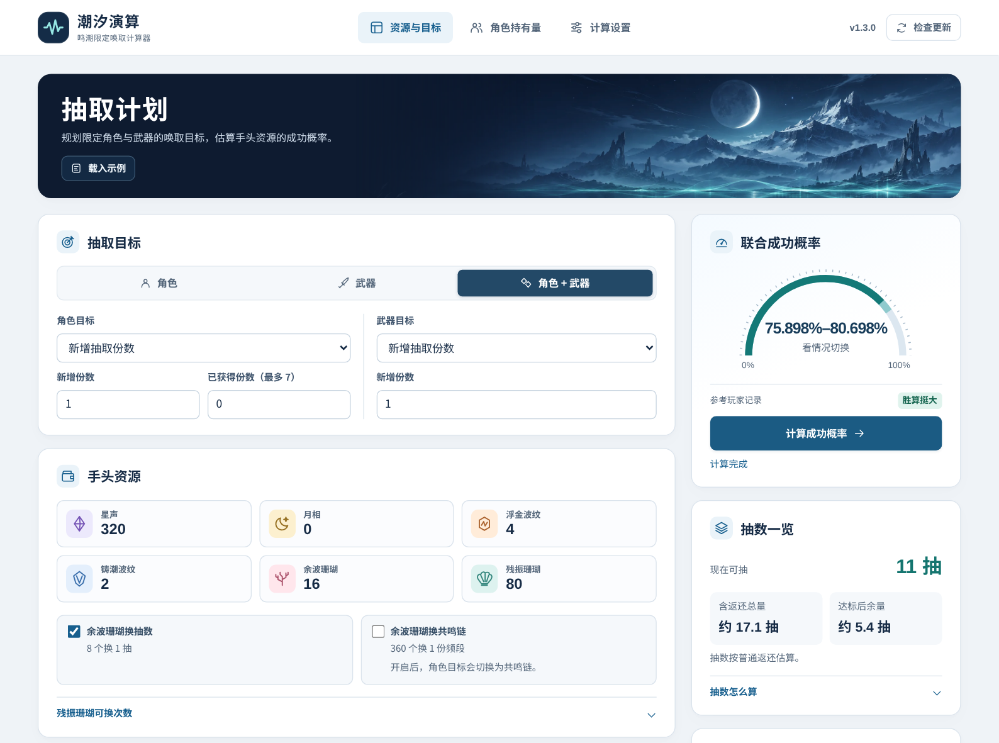

# 潮汐演算

《鸣潮》通用限定角色池和限定武器池的 macOS 抽取规划工具。输入现有资源、垫抽和持有量，查看角色、武器或联合目标的成功概率。计算逐抽消耗资源，也逐抽结算珊瑚返还和后续兑换。



## 安装与使用

从 [GitHub Releases](https://github.com/yunnre060214-sudo/wuwa-convene-planner/releases/latest) 下载 `macos-arm64` 版。要求 Apple Silicon 芯片和 macOS 13 或更新版本。解压后把 `TidePlanner.app` 拖到「应用程序」并打开。

本版使用临时签名，未通过 Apple 公证。若 macOS 拦截首次启动，核对下载来源和 Release 附带的 `SHA256SUMS.txt`，然后按 Apple 的「仍要打开」方式操作。[Apple 支持](https://support.apple.com/zh-cn/102445)

1. 在「资源与目标」选角色、武器或联合目标，填入本次可投入的资源和商店剩余库存。
2. 从所选的两类限定池记录填写五星、四星垫抽与 UP 保证。按共鸣链或谐振等级规划时，也要填写现有进度和可用份数。
3. 四星角色都已有 7 份时，在「角色持有量」选「四星全满 · 预设」即可。想把范围算窄些，只需填卡池里的四星角色数和武器数，数字包含当期 UP。持有量不一样时可逐个填写。
4. 在「手头资源」中分别设置余波珊瑚是否换抽数，以及共鸣链目标还可换几份频段。两种用途共用同一余额。
5. 点击「计算成功概率」。联合目标可比较角色优先、武器优先和看情况切换。概率附有档位评价，跨档时会标出来。
6. 「抽数一览」显示手头可抽次数、含返还的总估算和达标后折算余量。「计算设置」可调整保底曲线。

软件在本机计算并保存输入，无需登录游戏或连接服务器。浮金波纹用于限定角色，铸潮波纹用于限定武器，唤声涡纹用于常驻等池。忆旅、联动、新手、常驻和活动赠礼使用各自规则，属于通用限定池模型的范围之外。

## 应用内更新

点击「检查更新」（当前源码界面位于页尾，v1.3.0 安装版位于窗口右上角）。发现新版时，可以选择「下载并安装」，应用会核对本项目 GitHub Release 的文件校验值、版本和签名，安装后重新打开。应用需放在当前用户可写的位置，通常是「应用程序」文件夹。也可以从发布页下载 ZIP 手动替换。v1.1.1 升级到 v1.2.0 需要先手动替换一次。

## 算法和测试

引擎对每次唤取进行状态递推，追踪两池的进度、保底、目标份数、兑换余额与影响回流的角色持有量。动态策略通过逐状态选择动作求成功概率最大值。计算用向外舍入的整数概率区间。超过配置的状态上限时，返回有证明的上下界，界宽会随输入而变化。数学模型、规则来源与验证用例见 [技术说明](docs/model.md)。

## 从源码构建

需要 Go 1.24 或更新版本和 Node.js 22.12 或更新版本。正式构建使用 Go 1.27.4 与 Node.js 24。

```sh
npm ci
(cd engine && go test ./...)
npm test
npm run build:engine
npm start
```

在 Apple Silicon Mac 上打包并测试归档。

```sh
npm run package:mac
bash scripts/verify-mac.sh
```

`app/` 含 Electron 主进程、界面和启动测试。`engine/` 是 Go 概率引擎。`scripts/` 含构建和归档验证入口。GitHub Actions 在 Apple Silicon 上从 ZIP 解压、校验签名及架构，再启动应用执行端到端测试。

潮汐演算是独立玩家工具。游戏名称与规则归各自权利人。
